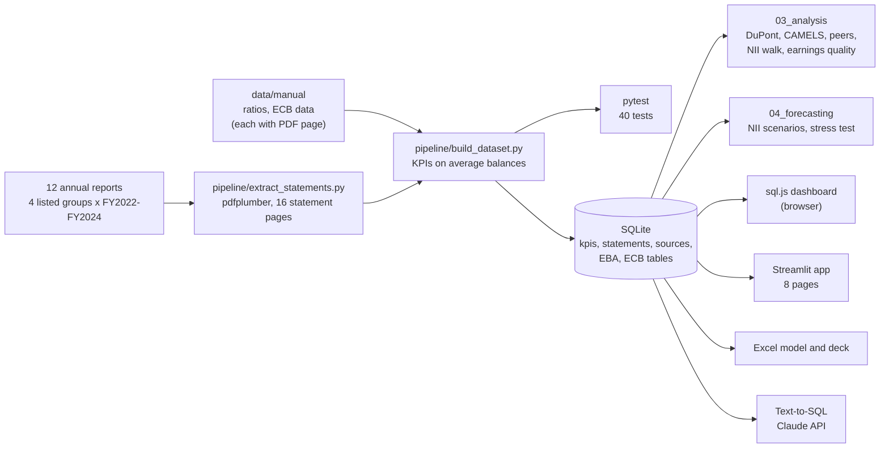

# Greek Banking Sector Analysis 2022–2024

> Financial analysis of the four listed Greek banking groups, built from their annual report PDFs. Every number in the database is traced to a report and page, and automated tests re-derive the KPIs from the statement lines.

[](https://greek-banking-sector-analysis.streamlit.app/)
[](https://phytai.com/dashboard/)
[](https://papastergiousp-maker.github.io/greek-banking-sector-analysis/)
[](https://github.com/papastergiousp-maker/greek-banking-sector-analysis/actions/workflows/ci.yml)


[](https://codecov.io/gh/papastergiousp-maker/greek-banking-sector-analysis)


---

### Why I built this

Greek bank results are published in long PDF annual reports, and each bank presents its statements a little differently. I wanted to build a comparison I could defend line by line, using only the published reports and free tools, and answer one question: which bank came out of the 2022–2024 rate cycle strongest, and where are the risks now that rates are falling?

The short answer is in [`03_analysis/00_executive_summary.ipynb`](03_analysis/00_executive_summary.ipynb).

---

### What the numbers say

- **Rates drove the income.** Sector net interest income (NII) rose 60%, from €5.4bn in 2022 to €8.6bn in 2024. In a rate/volume walk the margin explains all of the 2023 increase. In 2024 NII rose €497m, and €225m of that came from balance sheet growth, mostly Eurobank's consolidation of Hellenic Bank.
- **Different leaders on different measures.** In 2024 Eurobank had the highest return on equity (17.2%, RoTE 18.0%), NBG the highest net interest margin (3.15%) and CET1 ratio (18.3%), and Piraeus the lowest cost-to-income ratio (31.8%). Alpha had the lowest ROE (8.5%), but its CET1 ratio rose the most (13.2% to 16.3%).
- **2022 is not a clean base year.** One-off gains lifted 2022 profit at all four banks. On reported figures sector profit fell 3.5% in 2023; on underlying figures it rose about 42%.
- **Capital quality differs more than the ratios suggest.** Deferred tax credits, a tax claim on the Greek State counted in CET1, were 36% of CET1 capital at Eurobank and 63% at Piraeus at the end of 2024.
- **Stress.** In a simple one-year stress test (cost of risk +200bp, loans −15%, NIM −50bp, no dividends) only Alpha makes a loss (−€118m), and all four CET1 ratios stay above 15%. In the official EBA 2023 stress test Alpha also had the lowest adverse result (8.9% fully loaded CET1 at end-2025).
- **Outlook.** The ECB deposit rate fell to 2.00% in June 2025. A base scenario puts sector NII at €7.6bn in 2026 (−12% vs 2024). This is a rough guide: it assumes margins fall as fast as they rose, while banks hedge part of their rate risk.

---

### Data: entities, basis and checks

The data covers the companies listed on the Athens Exchange in 2022–2024, using their consolidated (group) statements from 12 annual reports:

| Bank | Listed group (2022–2024) |
|------|--------------------------|
| Alpha Bank | Alpha Services and Holdings S.A. |
| Eurobank | Eurobank Ergasias Services and Holdings S.A. |
| NBG | National Bank of Greece S.A. |
| Piraeus Bank | Piraeus Financial Holdings S.A. |

In 2025 each holding company merged with its bank, so the listed company is now the bank itself.

**One basis for every bank.** Each year comes from the latest report that contains it: 2024 and 2023 from the FY2024 reports (2023 restated), 2022 from the FY2023 reports (2022 restated). This matters: bank-level and holding-level reports, and first-published and restated figures, can differ by hundreds of millions.

**Checks.**
- Every statement line and ratio has its report file and PDF page (`sources` table, 335 numbers).
- 40 pytest tests re-derive ROE, ROA, NIM, cost of risk, cost-to-income and loan-to-deposit from the statement lines, check the balance sheet identity, compare key figures with the reports, compare the DTC share of CET1 with the banks' own disclosures, and compare ECB funding with the total for the Greek banking system.
- GitHub Actions runs the tests, eight notebooks and all eight Streamlit pages on every push.

---

### Data architecture



### KPI definitions

Averages are (opening + closing) / 2.

| KPI | Formula |
|-----|---------|
| ROE | Net profit attributable / average equity attributable to shareholders |
| RoTE | Net profit attributable / average (equity − AT1 − goodwill and intangibles) |
| ROA | Net profit attributable / average total assets |
| NIM | Net interest income / average total assets |
| Cost of risk | Loan impairments / average loans |
| Cost-to-income | Operating expenses / operating income |
| Loan-to-deposit | Loans / customer deposits (year end) |
| CET1, NPE ratio | As reported by each bank |
| DTC / CET1 | DTC / (CET1 ratio × RWAs) |
| Justified P/TBV | (RoTE − g) / (CoE − g), with assumed CoE and g |

Field-level details: [DATA_DICTIONARY.md](02_Banking_Sector_Dashboard/data/DATA_DICTIONARY.md).

---

### What this project covers

| Area | Where |
|------|-------|
| **PDF extraction and ETL**: pdfplumber, per-bank line rules, page references, unit handling | `02_Banking_Sector_Dashboard/pipeline/` |
| **SQL**: window functions (LAG, RANK), CTEs, conditional aggregation, joins | `sql/`, dashboard |
| **Financial analysis**: 5-step DuPont, CAMELS-style scorecard, peer z-scores, NII rate/volume walk, one-off adjustments | `03_analysis/` |
| **Scenarios and stress testing**: NII scenarios by ECB rate path, one-year stress test, official EBA 2023 results for context | `04_forecasting/`, Streamlit Forecast page |
| **Capital analysis**: CET1, deferred tax credits and CET1 without them, ECB funding repayment | Streamlit DTC and Macro pages |
| **Valuation logic**: RoTE against an assumed cost of equity, justified P/TBV (no market prices, not investment advice) | Streamlit Investment Thesis page |
| **Data quality**: 40 tests, CI on every push | `tests/`, `.github/workflows/ci.yml` |
| **Dashboards**: Streamlit app, browser-only sql.js dashboard, Power BI with DAX | `05_streamlit_app/`, `docs/`, `01_eurobank_pipeline/powerbi/` |
| **Excel model and deck**: built from the database with openpyxl and python-pptx | `deliverables/` |
| **Text-to-SQL**: questions in plain English answered with SQL written by the Claude API | `06_llm_qa/01_text_to_sql.ipynb` |

---

### Running it

**Live app:** [greek-banking-sector-analysis.streamlit.app](https://greek-banking-sector-analysis.streamlit.app/) · **Dashboard:** [phytai.com/dashboard](https://phytai.com/dashboard/)

```bash
git clone https://github.com/papastergiousp-maker/greek-banking-sector-analysis.git
cd greek-banking-sector-analysis
pip install -r requirements.txt

pytest tests/ -v                          # 40 tests
streamlit run 05_streamlit_app/app.py     # or: docker compose up --build, then http://localhost:8501
```

Pages: Overview · Bank Deep-Dive · Peer Comparison · Forecast & Stress · Methodology · Investment Thesis · DTC Analysis · Macro & Funding

**Rebuilding the data from the PDFs.** The PDFs are not stored in the repo (size). Download the 12 reports from the links in [`pipeline/sources.py`](02_Banking_Sector_Dashboard/pipeline/sources.py) into `02_Banking_Sector_Dashboard/data/raw/`, then:

```bash
python 02_Banking_Sector_Dashboard/pipeline/extract_statements.py   # PDF pages -> extracted_statements.csv
python 02_Banking_Sector_Dashboard/pipeline/build_dataset.py        # -> kpis, statements, sources CSVs
python 02_Banking_Sector_Dashboard/rebuild_db.py                    # -> SQLite (also copied to docs/data)
```

The processed CSVs and the database are in the repo, so the analysis runs without the PDFs.

**Static dashboard.** `docs/index.html` runs entirely in the browser with sql.js (SQLite compiled to WebAssembly). It is served by GitHub Pages and at phytai.com/dashboard.

---

## Project 1: Eurobank single-bank pipeline (Power BI)

A first, single-bank version of the pipeline: Eurobank's statements extracted from its annual reports, loaded into SQLite, KPIs in SQL and a Power BI dashboard with DAX measures.

**Entity and basis.** Eurobank S.A., the bank (consolidated statements), as first published in each year's annual report. The bank is wholly owned by the listed Eurobank Ergasias Services and Holdings, which Project 2 uses with restated figures, so the two projects differ slightly (for example, 2024 net profit is €1,458m here and €1,448m in Project 2).

| Step | Tool | What it does |
|:-----|:-----|:-------------|
| 1. Extract | Python, pdfplumber | Income statement and balance sheet lines from the annual report PDFs |
| 2. Clean | pandas | Wide and long tables in € million |
| 3. Load | SQLite | `01_eurobank_pipeline/data/eurobank.db` |
| 4. Query | SQL | KPIs with joins and window functions |
| 5. Visualise | Power BI, DAX | Dashboard with slicers and DAX measures |

| KPI | 2022 | 2023 | 2024 |
|:----|-----:|-----:|-----:|
| Net interest income | €1,551m | €2,174m | €2,504m |
| Operating income | €3,135m | €2,914m | €3,339m |
| Net profit attributable to shareholders | €1,336m | €1,148m | €1,458m |
| Cost-to-income | 29.0% | 31.1% | 32.6% |
| Loan-to-deposit | 72.7% | 71.9% | 64.6% |
| ROE (on year-end equity) | 20.1% | 15.2% | 16.9% |

Source pages (consolidated statements of Eurobank S.A.): FY2022 report p.37–38, FY2023 report p.40–41, FY2024 report p.179–180.

**What the numbers say**
- NII rose 61% from 2022 to 2024 as rates went up. The 2022 figure as first published still includes the Serbian subsidiary that the 2023 report shows as discontinued.
- 2022 operating income was lifted by €727m of trading income, mostly €550m of gains from unwinding interest rate swaps, and by a €325m gain on the sale of the merchant acquiring business. That is why the 2022 cost-to-income ratio (29.0%) is lower than in 2023 and 2024.
- Net profit rose 27% in 2024. Part of the rise is that 2023 included a €153m loss from discontinued operations.

Dashboard exports: `01_eurobank_pipeline/powerbi/` (being updated to the figures above).

---

## Project 2: Greek banking sector analysis

The four listed groups on the same definitions. Open the [dashboard](https://phytai.com/dashboard/) or the [Streamlit app](https://greek-banking-sector-analysis.streamlit.app/).

### Snapshot, 2024 (€ million)

| Bank | NII | Net profit | Total assets | ROE | RoTE | CET1 | NPE ratio |
|:-----|----:|-----------:|-------------:|----:|-----:|-----:|----------:|
| Eurobank | 2,507 | 1,448 | 101,150 | 17.2% | 18.0% | 16.8% | 2.9% |
| NBG | 2,356 | 1,158 | 74,957 | 14.4% | 15.5% | 18.3% | 2.6% |
| Piraeus Bank | 2,088 | 1,066 | 80,044 | 13.7% | 15.7% | 14.5% | 2.6% |
| Alpha Bank | 1,645 | 654 | 72,075 | 8.5% | 9.7% | 16.3% | 3.8% |

Eurobank 2024 includes Hellenic Bank (Cyprus) from 30 June 2024.

---

## Repository structure

```
greek-banking-sector-analysis/
├── 01_eurobank_pipeline/            Project 1: Eurobank data, SQLite and Power BI dashboard
├── 02_Banking_Sector_Dashboard/
│   ├── pipeline/                    sources.py, extract_statements.py, build_dataset.py
│   ├── data/
│   │   ├── raw/                     the 12 PDFs (not in the repo)
│   │   ├── manual/                  regulatory ratios, opening balances, EBA, ECB tables (with pages)
│   │   ├── processed/               extracted lines, statements, KPIs, sources
│   │   └── greek_banking_final.db   SQLite
│   ├── notebooks/                   01_extract (pipeline walk-through), 02_advanced_analysis
│   ├── index.html                   same dashboard as docs/
│   └── rebuild_db.py
├── 03_analysis/                     executive summary, DuPont, CAMELS, peers, NII walk, earnings quality
├── 04_forecasting/                  NII scenarios 2025–2026, stress test
├── 05_streamlit_app/                8-page app and smoke_test.py
├── 06_llm_qa/                       Text-to-SQL with the Claude API
├── deliverables/                    Excel model, deck and the scripts that build them
├── docs/                            browser dashboard for GitHub Pages
├── sql/                             standalone SQL examples
├── tests/                           pytest suite
└── .github/workflows/ci.yml         tests, notebooks and app pages on every push
```

---

## Limitations

1. Yearly data only, so intra-year effects (for example deposit repricing) cannot be measured.
2. Each bank presents income and costs in its own way, so cost-to-income ratios are close but not perfectly comparable.
3. The stress test is one year and static, with RWAs unchanged; the NII scenarios rest on three yearly points per bank.
4. AT1 coupons are not deducted in RoTE, which flatters Alpha and Piraeus slightly.
5. FY2025 results are now published. Adding them, as reported by the merged banks, is the natural next step and a test for the 2025 scenario.
6. The valuation page uses an assumed cost of equity and growth rate; no market prices are used.

---

## What I learned

- Choosing one entity and one basis for every bank is the first decision, not a detail. Every figure here comes from the listed group's latest report, with its page.
- Re-deriving each KPI from the statement lines in tests keeps the notebooks, the app and the dashboard on the same definitions.
- A browser-only dashboard with sql.js costs nothing to host and is easy to share.

---

## About the analyst

**Spyros Papastergiou**, financial and data analyst, Greece.

[](https://linkedin.com/in/spyros-papastergiou)
[](mailto:papastergiousp@gmail.com)
[](https://phytai.com)

---

*Greek Banking Sector Analysis 2022–2024 · data from the annual reports of the four listed groups · not investment advice*
